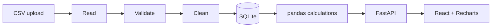

# Smart Shop Insights
Sales, profit and stock analytics for small grocery and provision stores. Built for the Calibo AI Academy.
**All demo data is synthetic (fictional store). It is not real business data.**

## Features
Overview dashboard (KPIs, trends, category chart, top 5 lists, stock alerts) · Sales Analytics (daily/weekly/monthly, searchable paged transactions) · Products (sort by revenue, units, gross profit) · Inventory (editable stock/reorder levels saved in SQLite) · guided CSV import with row-level errors and duplicate blocking · rule-based Business Insights · reset demo data.

## Architecture

Stack: React, TypeScript, Vite, Tailwind, Recharts, Lucide · FastAPI, pandas, NumPy, SQLAlchemy, SQLite, Pydantic · pytest.

## Run on Windows
Needs Python 3.11+ and Node 20+. Double-click `run_windows.bat`, or manually:
```
cd backend
python -m venv .venv && .venv\Scripts\activate
pip install -r requirements.txt
uvicorn app.main:app --port 8000
```
New terminal:
```
cd frontend
npm install
npm run dev
```
Open http://localhost:5173. API docs: http://127.0.0.1:8000/docs. No login (local demo only); authentication would be needed before storing several businesses' data.

## Tests
```
cd backend && python -m pytest -q      # calculations, CSV, inventory, insights + real API tests on a temp SQLite DB
cd frontend && npm run build           # TypeScript check + production build
```

## Calculations
Revenue = Σ qty × price · COGS = Σ qty × cost · Gross profit = revenue − COGS (NOT net profit; no operating costs/taxes) · Margin = profit ÷ revenue × 100 · Avg transaction = revenue ÷ distinct transactions. Percentage change is hidden when the previous period has zero revenue. Presets ("Last 30 days") count back from the latest sale date in the data.

## Database
`products` (catalogue + stock + reorder level) · `sale_lines` (unique `line_id`, FK to product) · `app_state` (demo flag).

## CSV rules
Columns: line_id, transaction_id, sold_at, product_id, quantity, unit_price, unit_cost (template at `/api/import/template`). Bad rows are reported, never silently dropped or turned into zero. **Duplicate policy:** a `line_id` already stored, or repeated in the file, is skipped and counted as a duplicate. Product IDs must already exist.

## Inventory
Low: stock ≤ reorder level · Out: stock = 0 · Healthy: above. Imported sales do **not** change stock; adjust stock on the Inventory page. Suggested reorder = ceil(avg daily units over last 30 days × cover days) − stock (cover days configurable, an estimate only).

## API summary
GET /api/health, /api/meta, /api/dashboard, /api/sales/timeseries, /api/products, /api/transactions, /api/inventory, /api/insights, /api/demo · PATCH /api/inventory/{id} · POST /api/demo/reset, /api/import/validate, /api/import/commit · GET /api/import/template

## Screenshots
_Placeholders: add real screenshots here after running the app._

## Limitations
No authentication; no frontend unit tests; forecasting not implemented; single fictional store; gross profit only.

## Future improvements
Frontend tests, auth, a transparent baseline forecast with a held-out error check, stock deduction rules, product catalogue import.

## Portfolio summary
A full-stack analytics app that turns grocery sales and stock records into clear, verifiable business information using a tested pandas pipeline, a REST API and a React dashboard.
